# CleanCheck — Java Code Quality Analyzer

> A local Java code analyzer that helps you find quality issues, understand security risks, apply supported fixes, and track code quality over time.

Java code can compile and run without errors and still be difficult to maintain. Empty methods, unclear structure, risky exception handling, and unsafe coding patterns may not stop the compiler, but they can make a project harder to understand and review.

**CleanCheck** analyzes Java source code without executing the project. It reports findings with their file, line, severity, explanation, and suggested next step. For selected findings, it can apply a controlled fix, analyze the project again, and keep or roll back the change based on verification.

**Analyze → Understand → Fix safely → Verify → Track**

---

## ✨ Features

- **Static analysis** — inspects Java source without running the analyzed project
- **38 analysis rules** — quality, educational SOLID checks, security patterns, and duplicate code
- **Severity levels** — `INFO`, `WARNING`, and `CRITICAL`
- **Detailed findings** — file, line, rule, severity, message, and suggested action
- **Quality score** — a 0–100 summary used to help prioritize work
- **Verified fixes** — backups, re-analysis, optional compilation checks, and rollback
- **Security Review** — preliminary findings mapped to CWE and OWASP Top 10 categories
- **Project metrics** — identify files and rules with the largest concentration of findings
- **Class Mode** — review and rank student projects for educational use
- **Regression tracking** — compare scans and identify new, resolved, or changed findings
- **Quality history** — store scan history locally
- **Report exports** — HTML, JSON, SARIF, and CSV
- **Command-line and CI modes** — scan a project and optionally enforce a quality gate
- **JavaFX desktop app** — 13 pages for analysis, findings, history, and configuration guidance
- **Local by default** — source code and scan history remain on the selected machine

---

## 🖥️ The CleanCheck Tool

CleanCheck brings project selection, analysis, issue explanations, security findings, metrics, and fix verification into one desktop application.

### Home

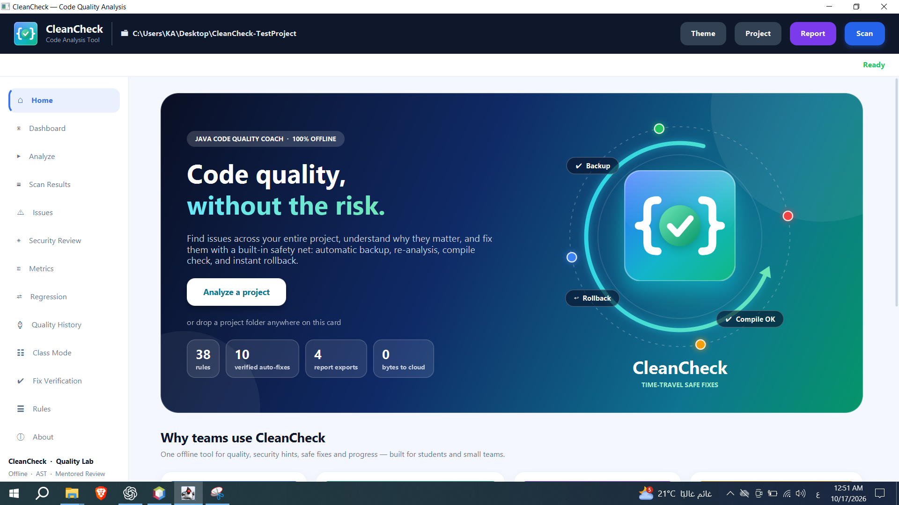

### Analyze a project

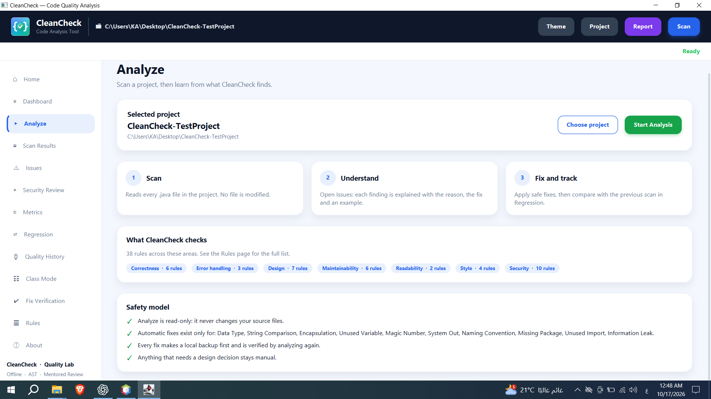

### Review findings and source code

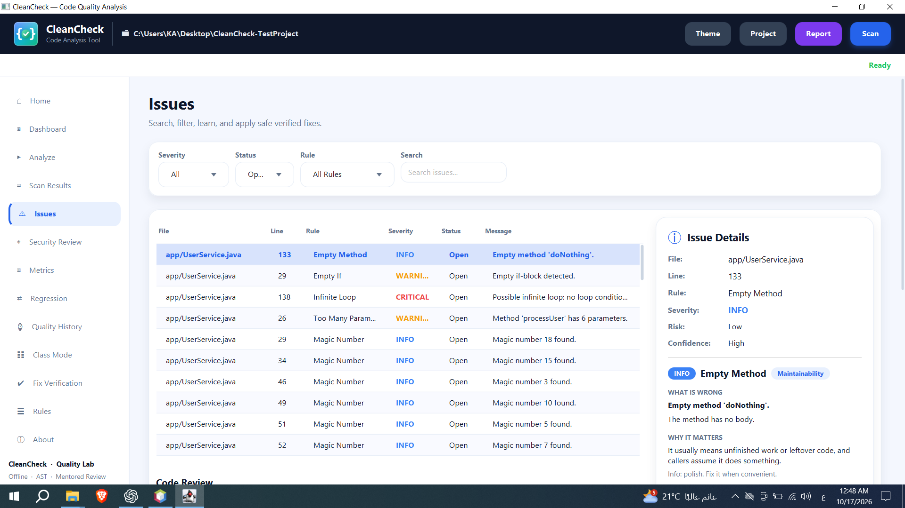

### Review security findings

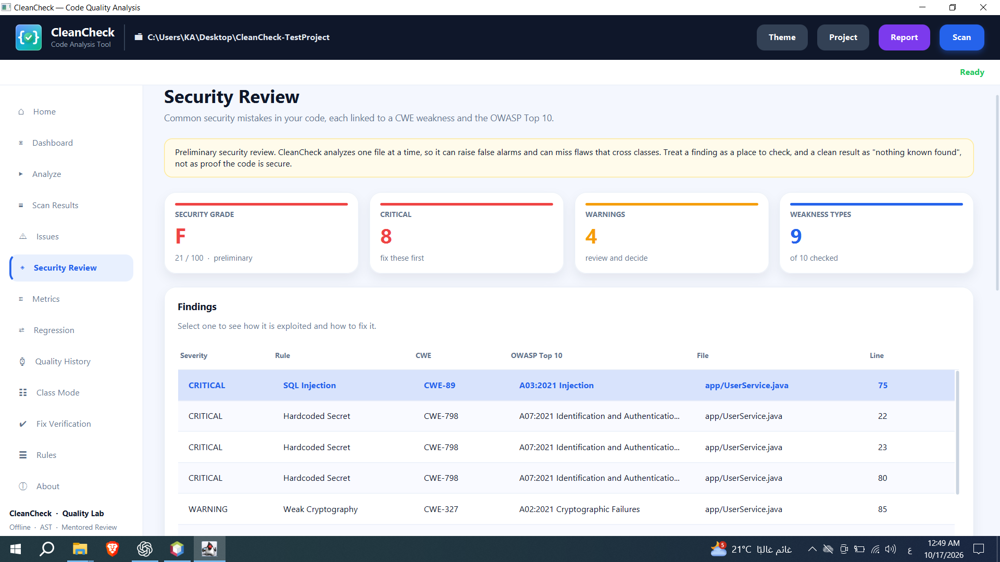

### Find the most important hotspots

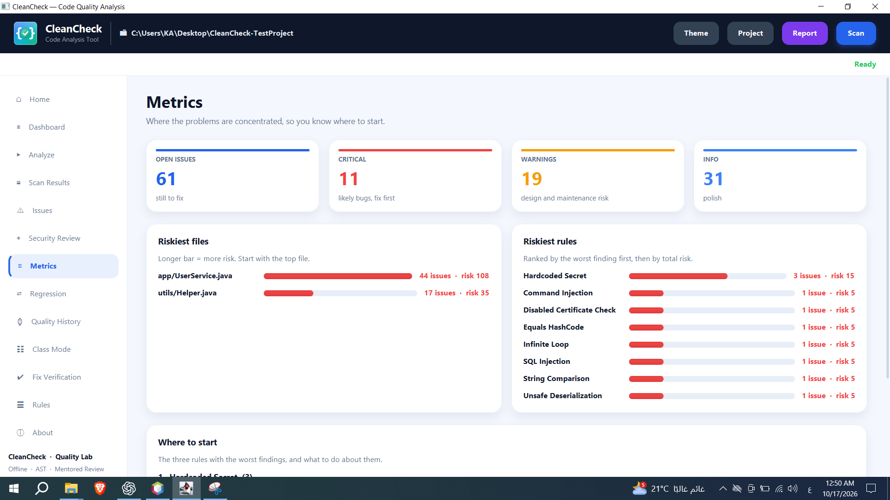

### Verify a supported fix

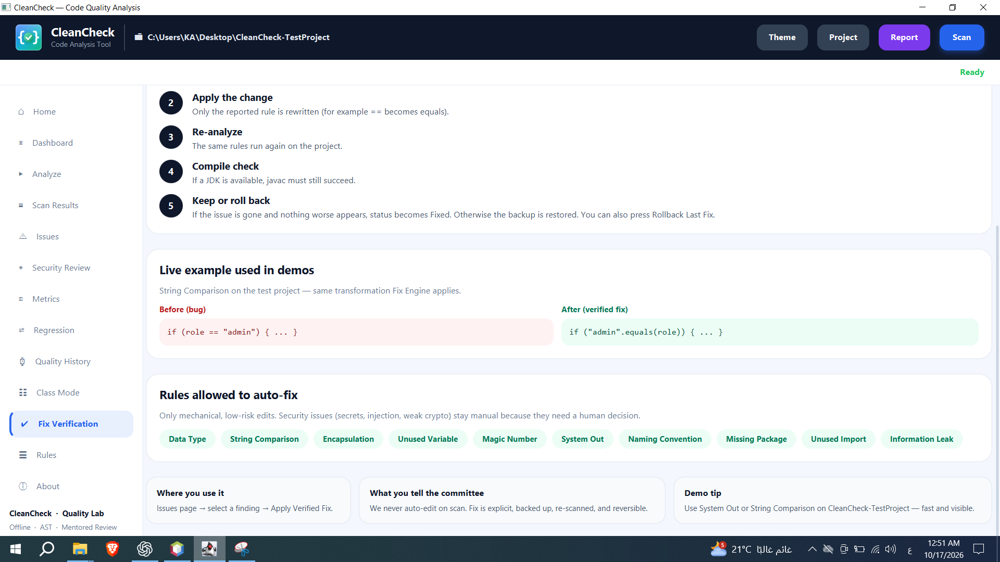

---

## 🚦 Quick Example

**Input** (`Student.java`):

```java
public class Student {
    String name; // Field is not private

    public void doNothing() {
    } // Empty method
}
```

**Example findings:**

| Rule | Severity | Example message |
|---|---|---|
| Encapsulation | WARNING | Field should be private |
| Empty Method | INFO | Method body appears to be empty |

The exact findings and score depend on the project, the enabled rules, and the configuration.

---

## 🔄 How Analysis Works

CleanCheck scans source files, parses Java syntax, runs enabled rules, and combines the findings into a result that the desktop app, CLI, and report exporters can use.

```text
Choose a project
      │
      ▼
Find Java source files
      │
      ▼
Parse Java source into AST
      │
      ├──► Quality rules
      ├──► SOLID checks
      ├──► Security checks
      └──► Project-wide duplicate-code check
                    │
                    ▼
             Analysis results
              ┌─────┼──────┐
              ▼     ▼      ▼
          Desktop  Reports  Local history
```

CleanCheck uses JavaParser to analyze Java syntax. A file that cannot be parsed is reported as a **Parse Error** finding instead of being silently treated as clean.

The analyzer excludes generated and tool-managed folders such as `.git`, `target`, `build`, `out`, and `.cleancheck-backups` from project scans.

---

## 🏗️ Architecture

The project separates source discovery, analysis rules, results, fixes, storage, reports, and the user interface.

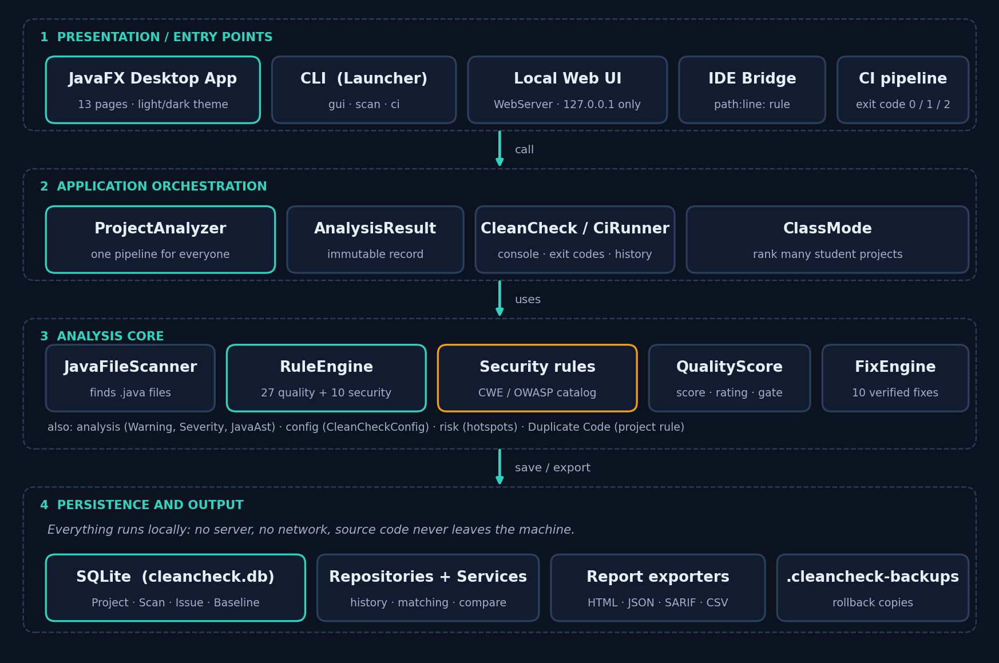

### Rule engine

The rule engine parses each Java file and shares its read-only AST with enabled rules. Project-wide checks, such as duplicate-code detection, run across the discovered source files.

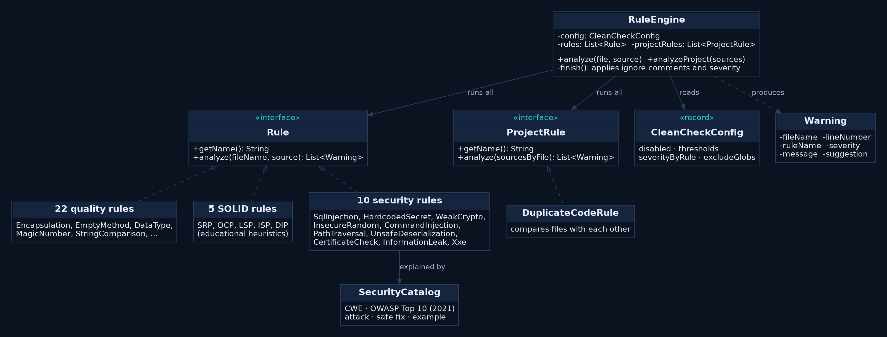

### Application components

The same analysis pipeline is used by the desktop app and command-line entry points. Results can then be shown in the UI, saved locally, or exported.

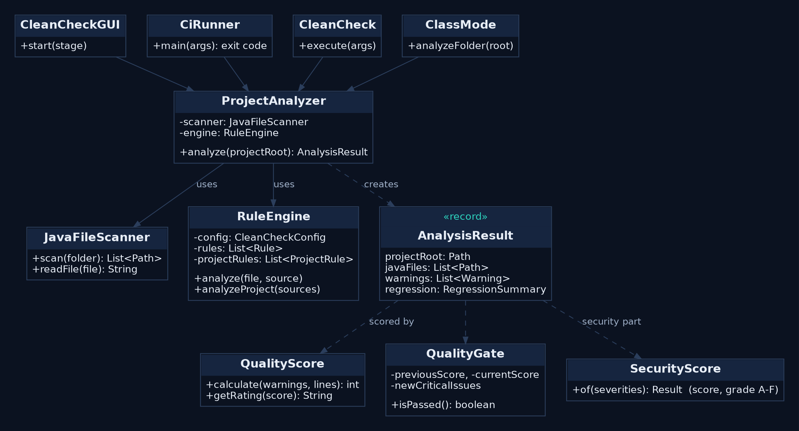

### Main source folders

```text
analysis/      Findings, analysis results, and analysis models
application/   Application orchestration, CLI, CI, Web UI, and IDE bridge
rules/         Quality, SOLID, and security rules
scanner/       Java source discovery and reading
quality/       Quality score and quality-gate calculations
risk/          File and rule risk ranking
fix/           Controlled source edits and verification
ui/            JavaFX pages and desktop interface
database/      SQLite persistence and repositories
report/        HTML, JSON, SARIF, and CSV exporters
classmode/     Educational class and project review
docs/          User guides, architecture, rules, and demo documentation
```

---

## 📋 The 13 Application Pages

| Page | Purpose |
|---|---|
| **Home** | Start a project review and return to recent projects |
| **Dashboard** | See the score and severity summary from the latest scan |
| **Analyze** | Select a project and start a read-only analysis |
| **Scan Results** | Review the most recent scan summary |
| **Issues** | Search, filter, inspect, and fix eligible findings |
| **Security Review** | Review preliminary security findings and their CWE/OWASP mappings |
| **Metrics** | Find risky files and rules to prioritize |
| **Regression** | Compare the latest scan with a previous scan |
| **Quality History** | Review saved scans over time |
| **Class Mode** | Review and rank student projects for educational use |
| **Fix Verification** | Understand the backup, fix, verification, and rollback process |
| **Rules** | Read about supported analysis rules |
| **About** | View the purpose and technical overview of CleanCheck |

---

## 🔍 Rules Reference

CleanCheck includes **38 rules**:

- **22 code-quality rules**
- **5 educational SOLID checks**
- **10 preliminary security rules**
- **1 project-wide duplicate-code rule**

### Code quality — 22 rules

| # | Rule | What it checks |
|---:|---|---|
| 1 | Encapsulation | Fields that may need to be `private` |
| 2 | Empty Method | Methods with empty bodies |
| 3 | Empty If | Empty `if` blocks |
| 4 | Empty While | Empty `while` blocks |
| 5 | Infinite Loop | Loops that may not terminate |
| 6 | Too Many Parameters | Methods with more parameters than the configured limit |
| 7 | Naming Convention | Names that do not follow the configured conventions |
| 8 | Data Type | Potential type issues |
| 9 | Empty Catch | Catch blocks with no meaningful handling |
| 10 | Magic Number | Numeric literals that may be clearer as named constants |
| 11 | Long Method | Methods that exceed the configured length |
| 12 | System Out | Direct console output |
| 13 | Missing Package | Java files without a package declaration |
| 14 | Unused Import | Imports that appear unused |
| 15 | Unused Variable | Variables that appear unused |
| 16 | Cyclomatic Complexity | Methods with high branching complexity |
| 17 | Deep Nesting | Excessively nested code |
| 18 | String Comparison | Potentially incorrect string comparisons |
| 19 | Generic Catch | Broad exception handling |
| 20 | Unclosed Resource | Resources that may not be closed |
| 21 | Equals HashCode | Potential inconsistency between `equals` and `hashCode` |
| 22 | Class Length | Classes that exceed the configured length |

### SOLID checks — 5 rules

- **SRP** — Single Responsibility Principle
- **OCP** — Open/Closed Principle
- **LSP** — Liskov Substitution Principle
- **ISP** — Interface Segregation Principle
- **DIP** — Dependency Inversion Principle

SOLID checks are educational heuristics that can help start a design review. They are not formal verification and may require human judgment.

### Security checks — 10 rules

| Rule | CWE | OWASP Top 10 (2021) |
|---|---|---|
| SQL Injection | CWE-89 | A03 Injection |
| Hardcoded Secret | CWE-798 | A07 Identification and Authentication Failures |
| Weak Cryptography | CWE-327 | A02 Cryptographic Failures |
| Insecure Random | CWE-338 | A02 Cryptographic Failures |
| Command Injection | CWE-78 | A03 Injection |
| Path Traversal | CWE-22 | A01 Broken Access Control |
| Unsafe Deserialization | CWE-502 | A08 Software and Data Integrity Failures |
| Disabled Certificate Check | CWE-295 | A07 Identification and Authentication Failures |
| Information Leak | CWE-209 | A04 Insecure Design |
| XML External Entity (XXE) | CWE-611 | A05 Security Misconfiguration |

### Project-wide duplicate-code rule

The duplicate-code rule compares code across the analyzed project. Unlike per-file rules, it needs to consider multiple source files to find repeated code.

---

## 🚨 Severity and Quality Score

Findings are assigned one of three severity levels:

| Severity | Meaning |
|---|---|
| **CRITICAL** | A likely bug, crash, or high-impact issue that should be reviewed first |
| **WARNING** | A design, maintenance, or security risk that needs review |
| **INFO** | A lower-impact improvement or cleanup opportunity |

The **Quality Score** summarizes the findings from a scan. It is intended as a project-specific prioritization and comparison aid, especially for before-and-after review. It is not an industry certification, a measure of security, or a guarantee of correctness.

---

## 🛡️ Verified Fixes

A normal scan is read-only. CleanCheck changes source files only when the user explicitly applies a supported fix from the Issues page.

The fix workflow is:

1. Create a local backup of the file.
2. Apply the rule-specific edit.
3. Re-analyze the project.
4. Check whether the finding is resolved and no worse result appeared.
5. Run a compiler check when a JDK is available.
6. Keep the edit if verification passes; otherwise restore the backup.

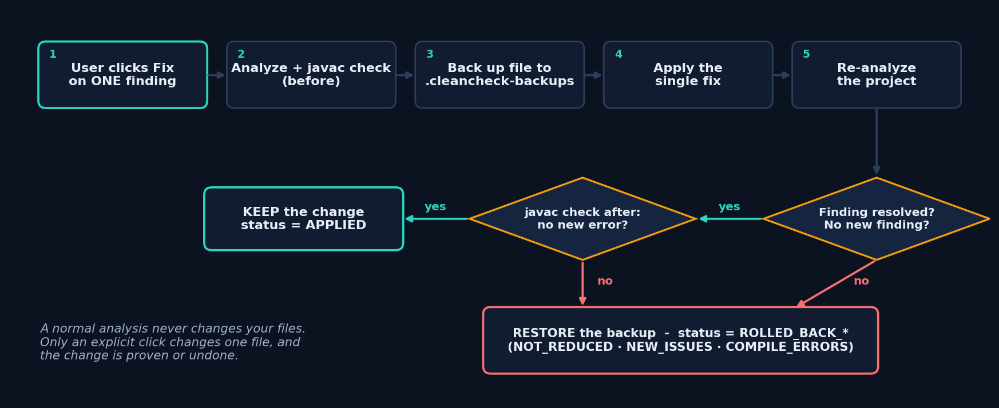

The supported automatic-fix categories are:

- Data Type
- String Comparison
- Encapsulation
- Unused Variable
- Magic Number
- System Out
- Naming Convention
- Missing Package
- Unused Import
- Information Leak (`printStackTrace()` handling)

A fix is offered only when CleanCheck considers the selected finding eligible. Many findings need a behavior or design decision, so they must be fixed manually. Review every diff and run the project’s own tests before shipping a change.

---

## 📈 Metrics, Regression, and History

### Metrics

The Metrics page ranks files and rules by their findings and risk. It helps answer questions such as:

- Which file should be reviewed first?
- Which rule contributes most to the current risk?
- Where are findings concentrated?

### Regression

After a code change, run another scan to compare it with a previous scan. Regression tracking helps identify new, resolved, or changed findings.

### Quality History

The desktop app stores scan history in a local SQLite database. A saved scan includes project and scan information, findings, and severity counts. The application can compare scans against a saved baseline.

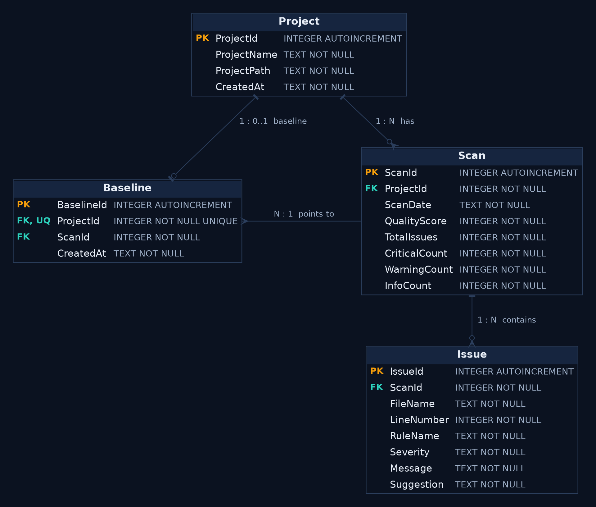

CI mode is read-only and does not require the desktop database.

---

## 📄 Reports and Integrations

CleanCheck can export analysis results in several formats:

| Format | Use |
|---|---|
| **HTML** | Readable standalone report for sharing or review |
| **JSON** | Structured results for scripts and integrations |
| **SARIF** | Findings format supported by code-scanning tools |
| **CSV** | Tabular results for spreadsheets and summaries |

The desktop app can create an HTML report from the **Report** action. CLI and CI modes can export reports without opening the GUI.

### Optional local Web UI

The optional Web UI runs on `127.0.0.1` and provides read-only GET endpoints. It is not exposed to other computers on the local network.

### IDE bridge

The IDE bridge provides a local connection point for editor integrations. See [`ide/README.md`](ide/README.md) for the current setup.

---

## 🆚 Why CleanCheck?

| Tool | Main focus | CleanCheck’s role |
|---|---|---|
| Checkstyle | Style and formatting | Adds issue explanations and review guidance |
| PMD | Code-quality rules | Offers a focused educational workflow |
| SpotBugs | Potential bugs | Complements bug-focused analysis |
| SonarQube | Broad quality and CI platform | Provides a lightweight local desktop option |

CleanCheck is not a replacement for these tools. It offers a local workflow for understanding findings, reviewing selected fixes, and tracking changes over time.

### CleanCheck + AI

AI assistants can help explain code and explore possible solutions. CleanCheck provides repeatable rule-based checks that run locally, giving you a consistent baseline to review alongside AI suggestions.

---

## 🛠️ Tech Stack

- **Java 26** — application and analysis code
- **JavaFX 26** — desktop interface
- **JavaParser 3.28.2** — Java source and AST analysis
- **SQLite JDBC 3.50.3.0** — local persistence
- **Maven** — build and dependency management
- **JUnit 5.11.4** — automated tests

---

## 🚀 Getting Started

### Requirements

- JDK 26
- Maven 3.9 or later
- Internet access for the first build to download dependencies
- After dependencies are downloaded, the app can be run offline

### Run the desktop application

From the repository root:

```bash
mvn clean javafx:run
```

### Analyze a project from the command line

Replace the example path with the folder you want to analyze:

```bash
mvn exec:java "-Dexec.mainClass=com.mycompany.cleancheck.application.CleanCheck" "-Dexec.args=C:/path/to/your-project --analyze-only"
```

### Export reports from the command line

```bash
mvn exec:java "-Dexec.mainClass=com.mycompany.cleancheck.application.CiRunner" "-Dexec.args=C:/path/to/your-project --html report.html --json report.json --sarif report.sarif --csv report.csv"
```

### Run a CI quality gate

```bash
mvn exec:java "-Dexec.mainClass=com.mycompany.cleancheck.application.CiRunner" "-Dexec.args=C:/path/to/your-project --json report.json --min-score 70 --fail-on-critical"
```

The CI runner returns:

| Exit code | Meaning |
|---:|---|
| `0` | Quality gate passed |
| `1` | Quality gate failed |
| `2` | Usage or I/O error |

`--min-score` sets the minimum score for the gate. `--fail-on-critical` makes the gate fail when critical findings exist.

### Build and run a JAR

```bash
mvn package
java -jar target/cleancheck.jar
```

The runnable JAR supports the GUI and command-line modes. By default, the package includes JavaFX native libraries for the build operating system. The `all-platforms` Maven profile can be used for a cross-platform package.

### Run tests

```bash
mvn test
```

---

## ⚙️ Configuration

CleanCheck loads `cleancheck.properties` from the root of the project being analyzed. To customize a project, copy [`cleancheck.properties.example`](cleancheck.properties.example) into that project as `cleancheck.properties`.

Configuration can be used to:

- Enable or disable rules
- Set method-length and parameter-count thresholds
- Set complexity, nesting, class-length, and duplicate-code thresholds
- Override the severity of a rule
- Exclude generated or otherwise irrelevant paths

Example:

```properties
rules.disabled = Magic Number, System Out

method.maxLines = 40
method.maxParameters = 4
method.maxComplexity = 10
nesting.maxDepth = 4
class.maxLines = 500
duplicate.minStatements = 5

severity.Magic_Number = INFO
severity.Generic_Catch = CRITICAL

exclude = **/generated/**
```

To suppress an individual finding, use a comment on the finding line or the line above:

```java
int timeout = 30; // cleancheck:ignore Magic Number
```

To suppress a rule on the following line:

```java
// cleancheck:ignore
int timeout = 30;
```

To suppress a file:

```java
// cleancheck:ignore-file
```

---

## 🗃️ Data and Privacy

- Project source is analyzed locally by the desktop app and CLI.
- Scan history is stored locally in SQLite by default at `database/cleancheck.db`.
- Backups for verified fixes are stored locally under `.cleancheck-backups`.
- The optional local Web UI binds to loopback (`127.0.0.1`).
- Report files are written only when you choose an export location.
- The first Maven build may need internet access to download dependencies.

You can use the JVM property `cleancheck.database.path` to select a different SQLite database file. You can use `cleancheck.config` to select an explicit configuration file.

---

## ⚠️ Security and Analysis Limitations

CleanCheck is a developer aid. It is not a replacement for a security audit, threat model, dependency scanner, compiler, or test suite.

- Security rules use AST and pattern-based checks and analyze one file at a time.
- A finding may be a false positive.
- A clean result can miss vulnerabilities, especially when data flow spans methods or classes.
- CleanCheck does not check third-party dependency versions for known vulnerabilities.
- SOLID results are design heuristics, not formal verification.
- A quality score helps prioritize work; it does not prove correctness or security.
- Review proposed changes, inspect the diff, and run your own tests before releasing software.

---


## 🤝 Contributing

Issues and pull requests are welcome.

When changing the analyzer:

- Add or update focused tests for rule behavior.
- Update documentation when a rule or workflow changes.
- Keep normal analysis read-only.
- Preserve the verified-fix safety sequence: backup → apply → re-analyze → compile check when available → keep or roll back.
- Run `mvn test` before submitting when your environment supports the required JDK and dependencies.

---


---

> Don’t just make your code work. Make it easier to understand, safer to change, and simpler to review.
